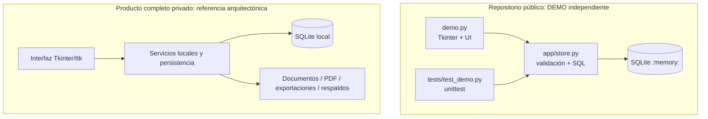

# Architecture · Arquitectura

## Dos aplicaciones separadas (no comparten datos ni código de ejecución)

**No existe una flecha de integración entre ambos subgrafos.** El código de este repositorio contiene únicamente la DEMO separada; la arquitectura privada es una descripción de alto nivel, no sus fuentes.

### Contratos revisables en la DEMO

- `DemoStore.reset()` cierra la conexión anterior, recrea un esquema en memoria y repuebla datos neutros.
- `foreign_keys=ON` obliga a respetar asociaciones cliente→caso; el rechazo de borrados vinculados se prueba.
- `money_to_cents()` exige importes positivos de hasta dos decimales, almacenados como enteros.
- `balances()` separa ARS, USD y EUR. No existen tipos de cambio ni conversiones.
- La aplicación no instala módulos adicionales y no usa almacenamiento, APIs remotas o recursos premium.

### Separación de responsabilidades

| Archivo | Propósito |
|---|---|
| `demo.py` | Ventana, vistas, formularios, navegación y estados del editor |
| `app/store.py` | Tablas, seed, consultas SQL y reglas de integridad de la demo |
| `tests/test_demo.py` | Verificación independiente de reglas de persistencia temporal |
| `screenshots/` | Capturas de la DEMO pública |
| `docs/screenshots/full-product/` | Capturas de producto PRIVADO tomadas en sesión sintética |

### No afirmar

La DEMO no prueba cobertura de pruebas del Full Source privado, ni derechos de redistribución de PyMuPDF, ni cifrado de datos, ni cómputos legales automáticos. La base profesional SQLite no se abre desde este repositorio.

[Decisiones de diseño](docs/DECISIONS.md) · [Comparación de funciones](docs/DEMO_VS_FULL.md)
