[README.md](https://github.com/user-attachments/files/33391022/README.md)
# ABOGADO Y ASOCIADOS — Legal Management Software

**Engineering Portfolio · Runnable Public DEMO · Private Full Product Showcase**  
**QuintaDimensión Tecnología** · Desktop Python / Tkinter / SQLite · 2026

[](https://github.com/carlos-adrian-ledesma/gestion-juridica/actions/workflows/ci.yml)

**DEMO pública:** `v1.0.0-demo.1` (código fuente, no `.exe`) · [Releases](https://github.com/carlos-adrian-ledesma/gestion-juridica/releases) · [Resultados de CI](https://github.com/carlos-adrian-ledesma/gestion-juridica/actions)

[English project guide](docs/README_EN.md) · [Guía para reclutadores](RECRUITER_GUIDE.md) · [Arquitectura](ARCHITECTURE.md) · [Pruebas](TESTING.md) · [Ejemplos de código](CODE_SAMPLES.md)

> **Dos productos diferenciados:** este repositorio publica una **DEMO reducida e independiente**, con su código y sus pruebas; las ocho imágenes de la **edición privada completa V1.0.6 RC1** permiten ver funcionalidades adicionales, **no disponibles en la DEMO**. Las capturas proceden de una ejecución del programa con **datos ficticios y nombres genéricos**.
>
> **Aviso:** no es un estudio jurídico ni software validado para gestionar expedientes reales. La edición completa continúa en evaluación; su fuente, instalación y dependencias no se distribuyen aquí.

## 1. Qué puede evaluar un reclutador / What recruiters can review

| Evidencia | Qué demuestra | Enlace |
|---|---|---|
| DEMO ejecutable desde código | Tkinter, navegación y operaciones CRUD ficticias | [`demo.py`](demo.py) · [`app/store.py`](app/store.py) |
| Pruebas automatizadas | Reglas SQL, integridad referencial, centavos y aislamiento | [`tests/test_demo.py`](tests/test_demo.py) |
| Arquitectura | Responsabilidades, almacenamiento, límites y decisiones | [ARCHITECTURE.md](ARCHITECTURE.md) |
| Código explicado | Métodos reales de la DEMO, casos de prueba y decisiones | [CODE_SAMPLES.md](CODE_SAMPLES.md) |
| Presentación del producto completo | Dashboard, gestión documental, herramientas PDF y otras pestañas | [Galería premium](#4-galería-de-la-edición-privada--full-product-gallery) |
| Estudio de caso | Problema, objetivos, ingeniería, validaciones y limitaciones | [TECHNICAL_CASE_STUDY.md](TECHNICAL_CASE_STUDY.md) |
| Alcance y estado | Qué está incluido, qué no, pendientes y próximos pasos | [PORTFOLIO_SCOPE.md](PORTFOLIO_SCOPE.md) · [ROADMAP.md](ROADMAP.md) |

## 2. Panorama del sistema profesional (no distribuido)

La edición completa es una aplicación local de gestión jurídica que presenta pantallas para **clientes, casos y expedientes, redacción de documentos, trabajo con PDF, archivo, agenda, actuaciones, evidencia, honorarios/finanzas, tareas, equipo, auditoría, papelera, respaldos y configuración**. Utiliza **Python, Tkinter/ttk, SQLite** y dependencias de documentos/reportes que se administran fuera de este repositorio público.

**Estas son capacidades presentes en el código de la edición privada y documentadas mediante capturas, no afirmaciones de validación operativa con expedientes reales.** Las funciones de firma PDF no deben confundirse con validación criptográfica y los plazos judiciales requieren revisión profesional. Ver [Matriz completa DEMO vs privada](docs/DEMO_VS_FULL.md).

## 3. Ejecutar la DEMO pública

La DEMO está escrita como aplicación autónoma y usa **solo bibliotecas estándar de Python**.

**Windows** (Python 3.10+ con Tkinter):

```bat
INICIAR_DEMO.bat
```

**Windows / Linux / macOS con Tkinter:**

```bash
python demo.py
```

- No requiere servidor, cuenta, API, wheelhouse, credenciales ni conexión a Internet.
- Crea una base **SQLite `:memory:`** nueva al iniciarse. Los cambios se eliminan al cerrar; **no accederá a la base del producto privado**.
- Podés probar Panel, Clientes, Casos/expedientes, Documentos, Agenda y Finanzas.
- El botón **Restablecer datos** repone los registros neutros de ejemplo.
- **No hay ejecutable `.exe` ni instalador empresarial**. Las pruebas GUI se hicieron sobre Linux con entorno gráfico virtual; la aceptación manual en Windows sigue pendiente.
- Nunca ingreses expedientes, nombres, DNI, datos sensibles ni documentos reales.

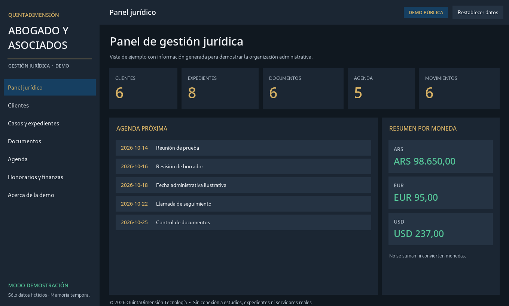

### Ver también: otras pantallas de la DEMO

| Documentos (DEMO) | Casos (DEMO) |
|---|---|
| [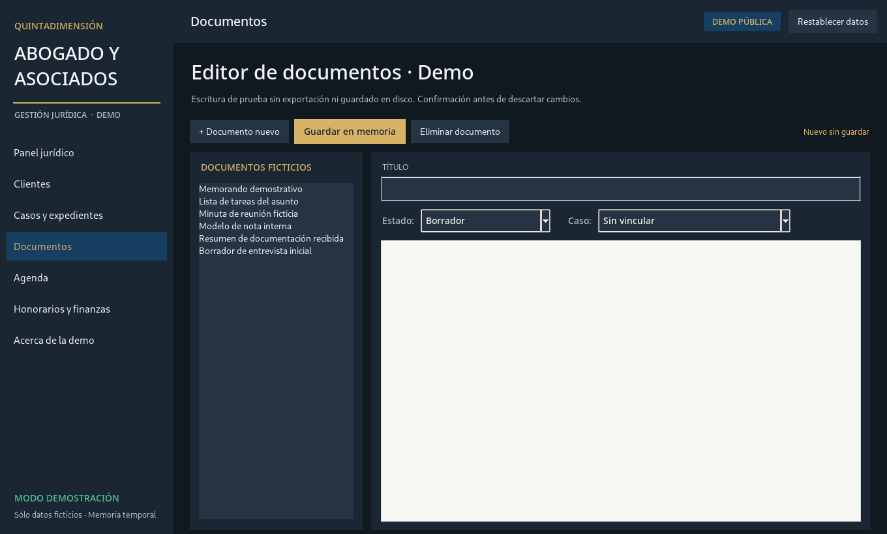](screenshots/02_DOCUMENTOS_DEMO.png) | [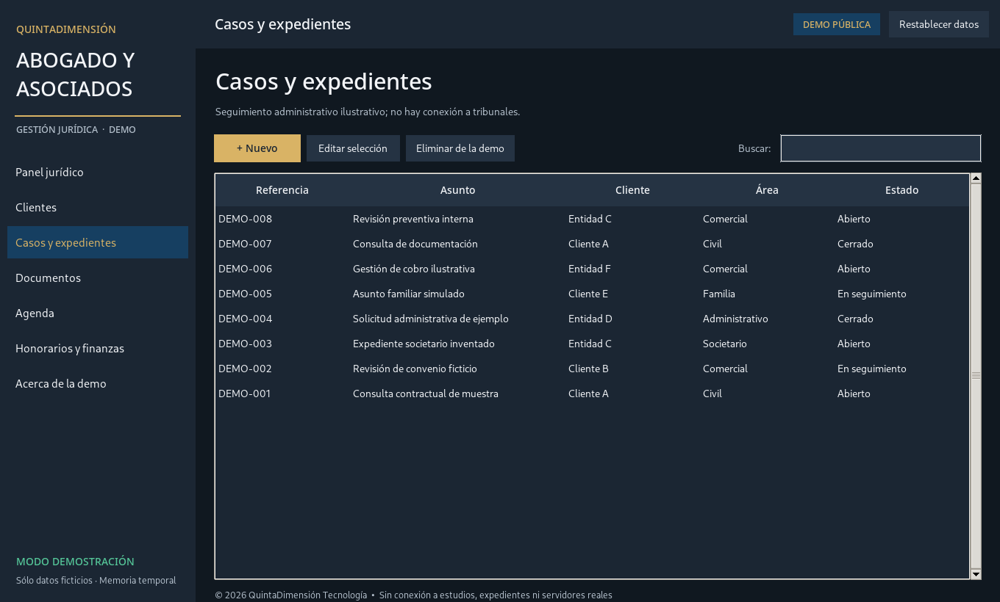](screenshots/03_EXPEDIENTES_DEMO.png) |

## 4. Galería de la edición privada · Full product gallery

**Las 8 capturas siguientes corresponden al programa completo V1.0.6 RC1, no a la DEMO descargable.** Las imágenes muestran la interfaz real ejecutada con una base aislada, expedientes de prueba, identificadores como `Cliente A` y `Entidad B`, y un PDF creado solo para demostración. No se han utilizado clientes o causas reales. [Protocolo de capturas](docs/SCREENSHOT_PROVENANCE.md).

### Dashboard profesional

[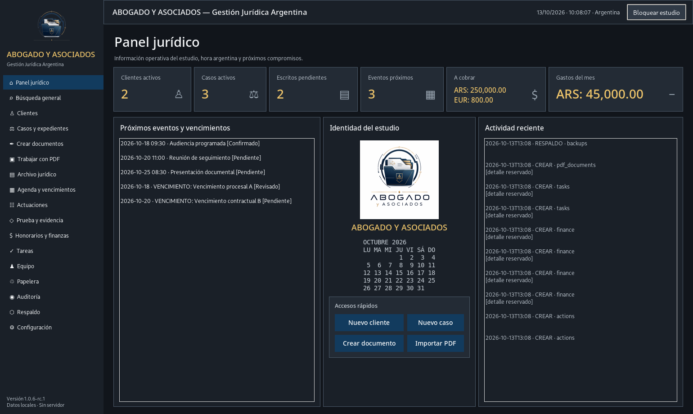](docs/screenshots/full-product/01_dashboard_panel_juridico.png)

### Espacio de trabajo PDF

[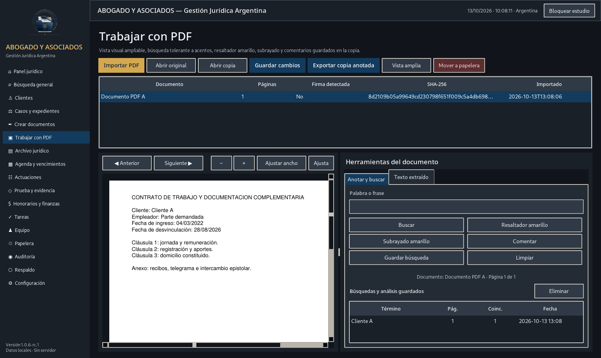](docs/screenshots/full-product/05_trabajo_con_pdf.png)

### Más módulos de la edición completa

| Clientes | Casos y expedientes |
|---|---|
| [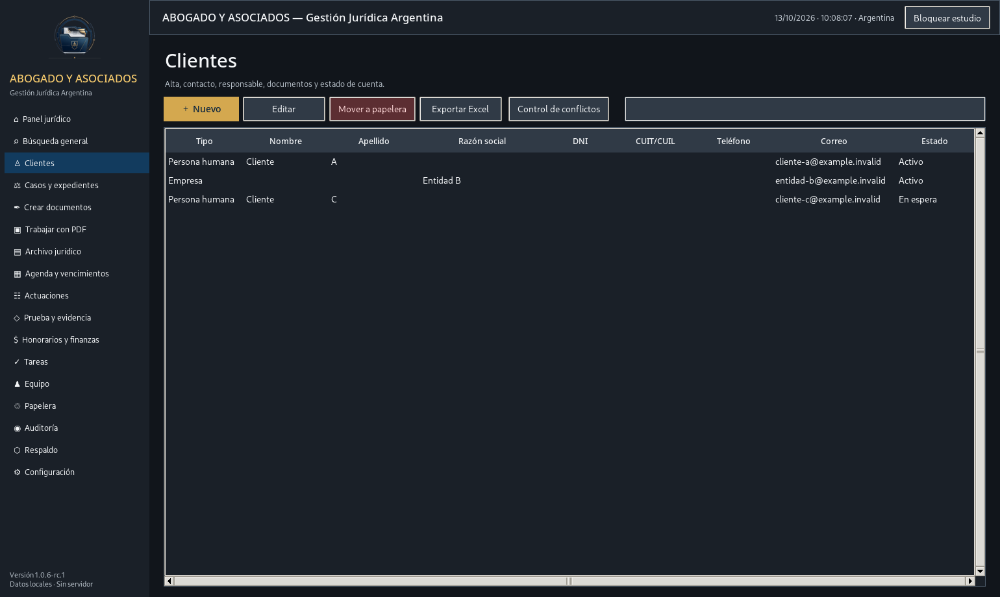](docs/screenshots/full-product/02_clientes_activos.png) | [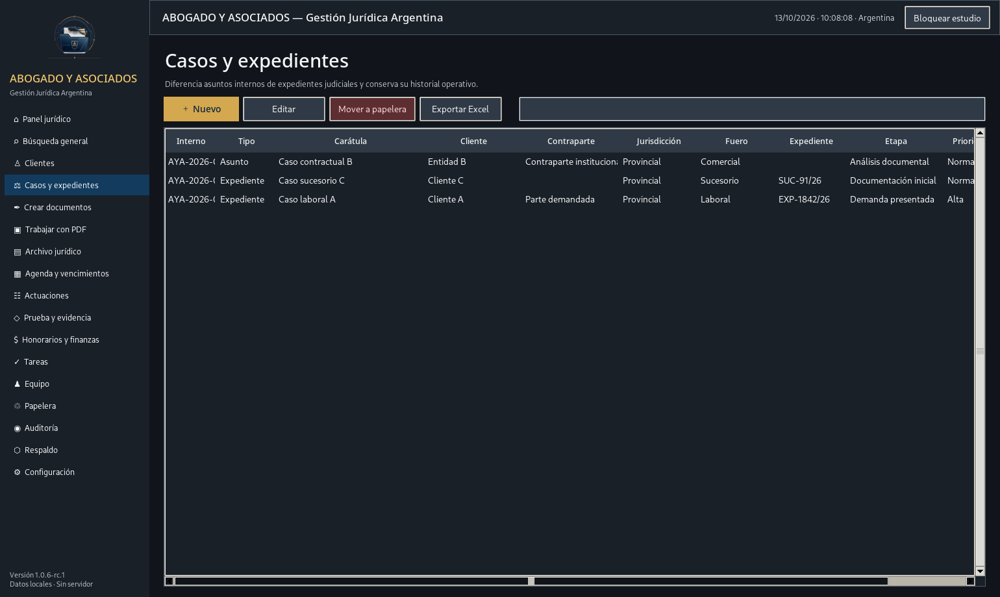](docs/screenshots/full-product/03_casos_y_expedientes.png) |
| **Editor jurídico** | **Agenda y vencimientos** |
| [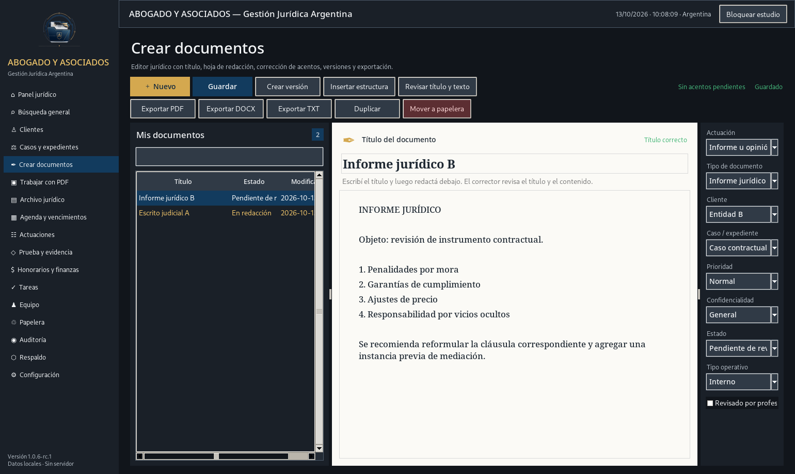](docs/screenshots/full-product/04_editor_documentos.png) | [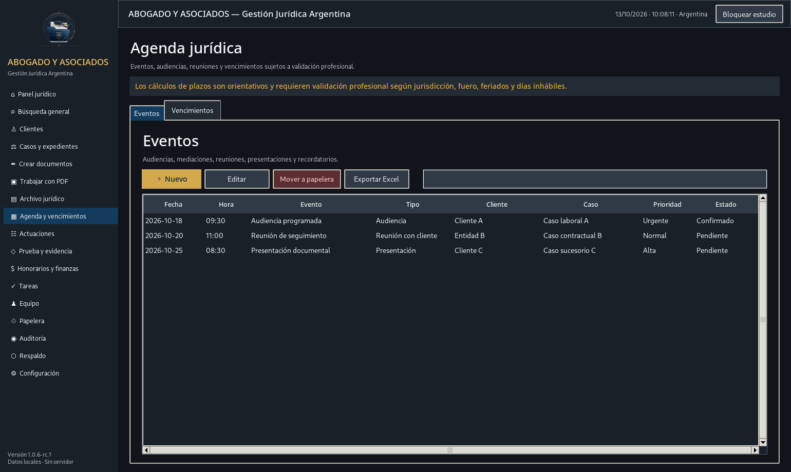](docs/screenshots/full-product/06_agenda_y_vencimientos.png) |
| **Honorarios y finanzas** | **Respaldos** |
| [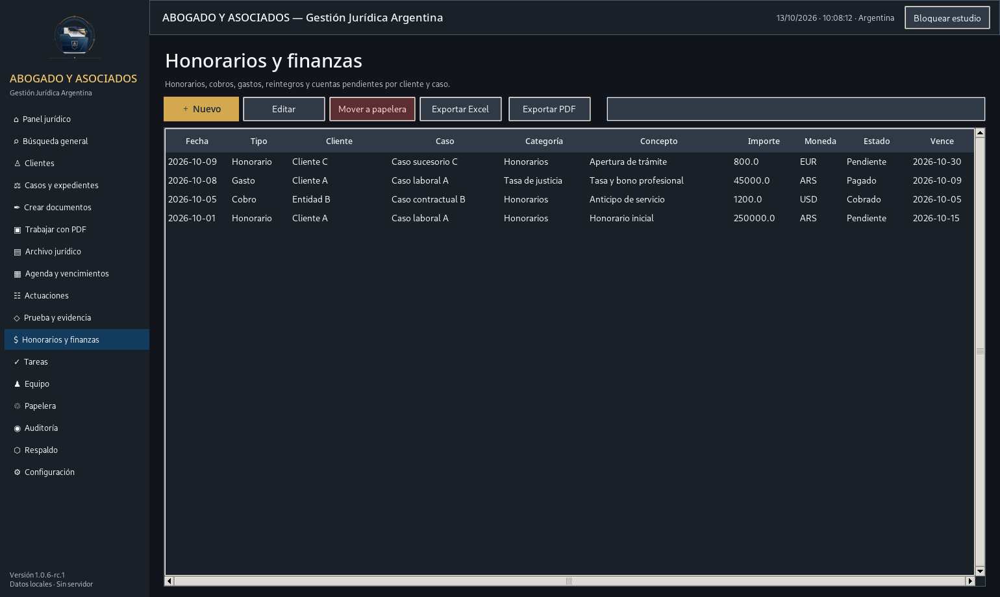](docs/screenshots/full-product/07_honorarios_y_finanzas.png) | [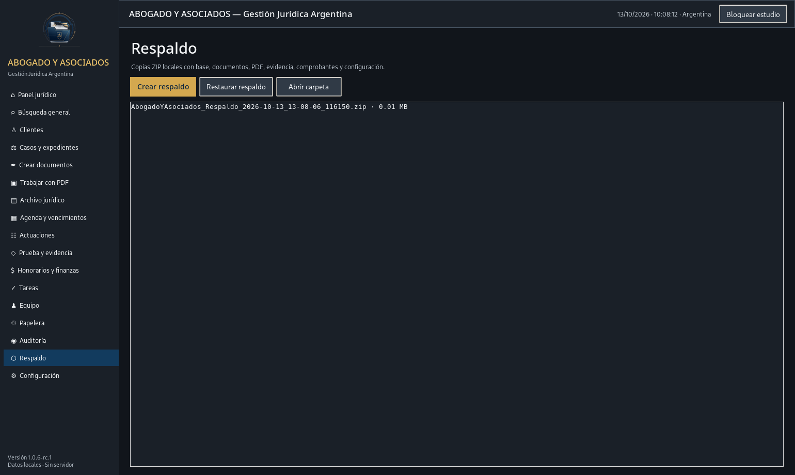](docs/screenshots/full-product/08_respaldo_y_restauracion.png) |

## 5. Diseño y calidad técnica de la DEMO

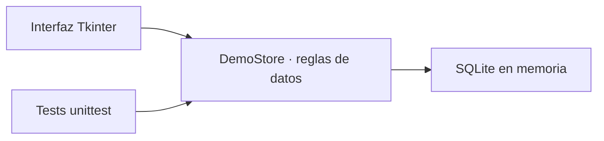

En este repositorio se pueden inspeccionar operaciones con **SQL parametrizado**, **integridad referencial SQLite (`PRAGMA foreign_keys=ON`)**, **centavos enteros para importes**, **balances por divisa** y **reinicio controlado de fixtures**. Esta implementación reducida no es una publicación del código comercial.

```bash
python -m unittest discover -s tests -v
python -m compileall -q demo.py app tests
```

**Verificación registrada:** 16/16 pruebas unitarias aprobadas durante la preparación local (Linux), con capturas de la GUI tomadas mediante Xvfb. GitHub Actions ejecutó correctamente **las cuatro combinaciones** de compilación de fuentes y tests: Windows y Ubuntu, cada uno con Python 3.11 y 3.12. [Consultar la ejecución verificada del 13/10/2026](https://github.com/carlos-adrian-ledesma/gestion-juridica/actions/runs/38412555905) y el [workflow](.github/workflows/ci.yml). **Esto no acredita** el inicio visual de la aplicación ni el doble clic en `INICIAR_DEMO.bat` en Windows: esas pruebas manuales siguen pendientes. Consultar [TESTING.md](TESTING.md).

## 6. Transparencia, seguridad y propiedad intelectual

- **Código público:** exclusivamente implementación autónoma de la DEMO, pruebas y documentación.
- **Código privado:** el producto completo, migraciones, instalador, motores PDF, wheelhouse y datos operativos **no se publican**.
- **Información:** la DEMO trabaja en RAM; no contiene datos de estudio, clientes reales, contraseñas ni dependencias de terceros distribuidas.
- **Funciones jurídicas:** la DEMO no valida firmas digitales, no computa plazos oficiales ni se conecta con tribunales.
- **Derechos:** código de autor con **todos los derechos reservados**; repositorio de exhibición **no open source**. Ver [LICENSE](LICENSE), [THIRD_PARTY_NOTICES.md](THIRD_PARTY_NOTICES.md), [SECURITY.md](SECURITY.md) y [PRIVACY.md](PRIVACY.md).

## 7. Estado y evaluación

| Componente | Estado |
|---|---|
| DEMO en código fuente | Disponible, independiente, sin persistencia |
| Tests SQLite / reglas DEMO | **16/16 PASS** (preparación Linux); CI de sintaxis y tests: **4/4 entornos PASS** (Windows/Linux, Python 3.11/3.12) |
| Capturas de la edición completa | 8 imágenes auténticas, solo datos sintéticos |
| Ejecución manual Windows de esta entrega | **Pendiente** |
| Uso con expedientes jurídicos reales | **NO VALIDADO** |
| Full Source privado | No publicado |
| Distribución comercial/instalador premium | Fuera del alcance |

Revisá [ROADMAP.md](ROADMAP.md), [CHANGELOG.md](CHANGELOG.md) y [recomendaciones para entrevistas](RECRUITER_GUIDE.md).

---

**Autor:** Carlos Adrián Ledesma · **QuintaDimensión Tecnología**  
[GitHub @carlos-adrian-ledesma](https://github.com/carlos-adrian-ledesma)  
© 2026 QuintaDimensión Tecnología. **Todos los derechos reservados.**
